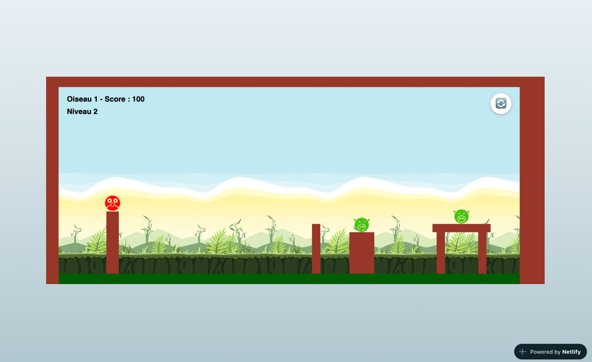

# Angry Birds 

Version simplifiée du jeu développé ici en JavaScript vanilla, utilisant la 
physique 2D et un rendu graphique dynamique.

[Jouer en ligne](https://angry-bird-smash.netlify.app/)

### Aperçu 

## 1. Contexte 

Projet réalisé dans un but pédagogique pour apprendre à manipuler un moteur de 
physique en deux dimensions et à gérer des rendus graphiques interactifs en 
JavaScript.

**But du jeu** : utiliser un lance-pierre pour projeter des projectiles (des oiseaux) 
sur des structures afin de détruire les cibles (des cochons). 
Le jeu calcule en temps réel les trajectoires, la force des impacts et 
l'effondrement des structures de manière réaliste.

## 2. Principales fonctionnalités 

### 2.1. Jeu basé sur la physique

- **Le lance-pierre Sling-shot**: le joueur utilise un lance-pierre pour propulser 
les oiseaux sur les structures des cochons. Le contrôle se fait 
intuitivement en glissant le doigt pour régler l'angle et la puissance du tir.

- **Moteur physique en temps réel**: les structures (en bois, glace/verre ou pierre)
s'effondrent de manière réaliste en fonction des impacts et de la gravité.

### 2.2. Diversité des oiseaux

- **rouge** : classique, sans pouvoir spécial 
- **jaune** : accélère en ligne droite
- **noir** : explose sur commande 
- **bleu** : se divisent en trois petits oiseaux
- **blanc** : pond un œuf explosif et est propulsée vers le haut

### 2.3. Système de progression et score

- **Évaluation** : chaque cochon tombé au sol rapporte 100 points.

- **Mondes et thématiques** : les niveaux sont au nombre de 10 avec des décors 
différents et des configurations de plus en plus complexes.

## 3. Installation et lancement du jeu

Le projet utilise des CDN pour charger les bibliothèques nécessaires, il n'y a 
donc **aucune installation ou configuration complexe requise** 
(pas besoin de `npm install`).

Pour lancer le jeu localement :

1. Clonez ou téléchargez ce dépôt sur votre ordinateur.
2. Ouvrez le fichier `index.html` directement dans le navigateur web.
3. *Optionnel (recommandé):* sur VS Code, il y a l'extension **Live Server** 
pour lancer le projet rapidement. 

## 4. Technologies

- **[Matter.js](https://brm.io/matter-js/) (v0.19.0, version stable) :** 
C'est le moteur de physique 2D du projet. Il gère toute la partie invisible mais cruciale du jeu : 
la gravité, la vitesse de propulsion via le lance-pierre, les forces d'impact, 
les frictions entre les blocs et la détection des collisions.

- **[p5.js](https://p5js.org/) (v1.9.0) :** C'est la bibliothèque de rendu graphique. 
Elle est connectée au moteur physique pour dessiner en temps réel (à 60 images par seconde) 
les éléments du monde (oiseaux, blocs, décors) à partir des coordonnées calculées par Matter.js.

Pour trouver les liens CDN: `cdnjs.com` (bibliothèque publique qui héberge les 
fichiers de presque toutes les extensions JavaScript)

## 5. Fonctionnement technique (Architecture de Matter.js)

Pour structurer le jeu, j'ai utilisé les composants clés de Matter.js 
en les couplant avec p5.js:

- **L'Engine (moteur) :** c'est le cerveau du jeu. 
Il effectue tous les calculs mathématiques complexes dans l'ombre 
(gravité, vitesse de frappe, forces lors des impacts).

- **Le World (monde) :** c'est la scène de théâtre. 
C'est l'espace virtuel dans lequel on ajoute tous les éléments de notre jeu.

- **Les Bodies (corps) :** ce sont les acteurs. Ce sont les formes physiques 
qui subissent les lois de la gravité (un cercle pour l'oiseau, des rectangles 
pour le sol et les blocs de la structure).

- **Le Rendu graphique :** utilisation du module `Render` par défaut de Matter.js
qui écoute le "cerveau" (l'Engine) et dessine les objets à l'écran 60 fois par seconde. 

